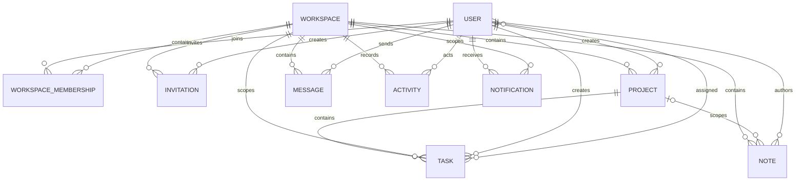

# Data relationships

`WorkspaceMembership` is the source of workspace permissions. It has a unique `(workspace, user)` index and a partial unique owner index. Routes resolve the resource's workspace and check membership before returning or changing private data. Invitation documents store a SHA-256 token hash, expiry, role, and use count; the raw token appears only in the generated link.

Messages are workspace-scoped in v1. Notes may belong to a workspace or to one project within that workspace. Tasks retain both `workspace` and `project` references so workspace filtering and permission checks do not depend on client-supplied project data.
